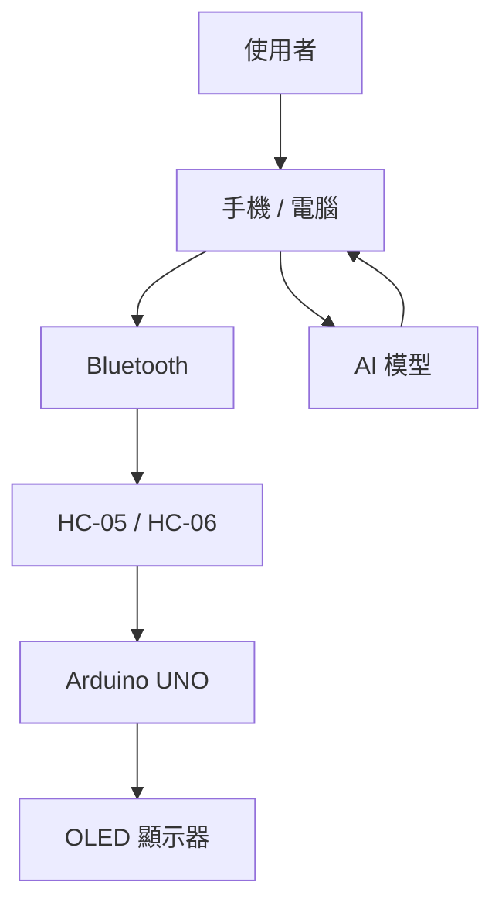

AI FocusMate
智慧藍牙番茄鐘暨桌面 AI 陪伴裝置
1. 專題簡介
本專題使用 Arduino UNO、HC-05／HC-06 藍牙模組與 OLED 顯示器，製作一個可由手機或電腦控制的智慧番茄鐘。使用者可以設定專注時間，OLED 會顯示倒數時間、目前狀態、簡單角色表情與 AI 產生的簡短鼓勵訊息。
2. 專題動機
傳統番茄鐘通常只有倒數功能。本專題加入藍牙控制、OLED 顯示與 AI 陪伴，希望讓時間管理工具更有互動性與趣味性。
3. 專題目標
1. 完成藍牙控制的番茄鐘。
2. OLED 顯示倒數時間與狀態。
3. 支援開始、暫停、繼續與重設。
4. OLED 顯示簡單角色表情。
5. 顯示 AI 產生的簡短鼓勵或提醒訊息。
6. 完成可實際展示的桌面原型。
4. 主要功能
- 手機或電腦透過藍牙設定番茄鐘。
- OLED 顯示剩餘時間。
- 支援 START、PAUSE、CONTINUE、RESET。
- 顯示 FOCUS、BREAK、DONE 等狀態。
- 顯示桌面角色表情。
- 顯示 AI 鼓勵或提醒訊息。
5. 指令規劃
指令	功能
P25	設定 25 分鐘
P50	設定 50 分鐘
START	開始
PAUSE	暫停
CONTINUE	繼續
RESET	重設

6. 系統架構

7. 使用流程
手機 / 電腦設定時間
        ↓
Bluetooth 傳送指令
        ↓
Arduino 接收資料
        ↓
OLED 顯示倒數時間
        ↓
番茄鐘完成
        ↓
OLED 顯示完成畫面
        ↓
顯示 AI 鼓勵 / 提醒訊息
8. 預計使用硬體
元件	用途
Arduino UNO	系統主要控制器
HC-05 / HC-06	藍牙通訊
OLED 128×64	顯示時間、狀態、角色與 AI 訊息
手機或電腦	設定番茄鐘與處理 AI 訊息

9. 預計使用軟體
軟體	用途
Arduino IDE	Arduino 程式開發
C / C++	Arduino 控制程式
Bluetooth Terminal	手機藍牙測試
Python（選配）	電腦端通訊與 AI 整合
GitHub	專題文件與程式碼管理
AI 模型／API	產生陪伴訊息

10. 兩人分工
組員 A
- Arduino 程式
- 藍牙通訊
- 番茄鐘功能
- OLED 顯示
- 硬體接線與測試
組員 B
- AI 訊息功能
- 手機／電腦端控制
- GitHub 文件整理
- 角色內容設計
共同完成
- 系統整合
- 測試
- 外觀設計
- Demo 與簡報
11. 預期成果
完成一個可放置於桌面的智慧番茄鐘原型。使用者可透過手機或電腦藍牙設定與控制番茄鐘，並在 OLED 上查看倒數時間、狀態、角色表情與 AI 產生的簡短鼓勵訊息。
