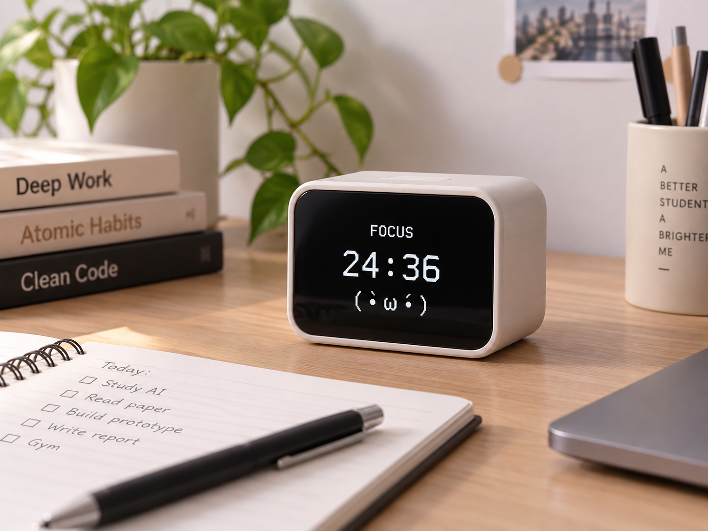

AI FocusMate
智慧藍牙番茄鐘暨桌面 AI 陪伴裝置
結合 Arduino、Bluetooth、OLED 與 AI 陪伴訊息的桌面專注工具。

assets/product_concept.png

專題介紹
AI FocusMate 是一個智慧桌面番茄鐘。使用者可透過手機或電腦，以 Bluetooth 傳送指令到 Arduino，設定番茄鐘並控制開始、暫停、繼續與重設。OLED 會顯示倒數時間、目前狀態、簡單角色表情，也可顯示 AI 產生的簡短鼓勵或提醒訊息。
主要功能
- 藍牙設定番茄鐘
- 開始、暫停、繼續、重設
- OLED 顯示剩餘時間
- 顯示專注、休息與完成狀態
- 顯示桌面角色表情
- 顯示 AI 鼓勵或提醒訊息
系統架構
flowchart LR
    A[使用者] --> B[手機 / 電腦]
    B --> C[Bluetooth]
    C --> D[HC-05 / HC-06]
    D --> E[Arduino UNO]
    E --> F[OLED 顯示器]
    B --> G[AI 模型]
    G --> B

  操作方式
1. 手機或電腦連線至 HC-05／HC-06。
2. 傳送 P25 或 P50 設定時間。
3. 傳送 START 開始倒數。
4. OLED 顯示剩餘時間與角色狀態。
5. 可用 PAUSE、CONTINUE、RESET 控制。
6. 計時完成後，OLED 顯示完成畫面。
7. AI 產生的短訊息可再傳送到 OLED 顯示。
預計指令
| 指令 | 功能 |
|---|---|
| `P25` | 設定 25 分鐘 |
| `P50` | 設定 50 分鐘 |
| `START` | 開始 |
| `PAUSE` | 暫停 |
| `CONTINUE` | 繼續 |
| `RESET` | 重設 |

| 指令 | 功能 |
|---|---|
| `P25` | 設定 25 分鐘 |
| `P50` | 設定 50 分鐘 |
| `START` | 開始 |
| `PAUSE` | 暫停 |
| `CONTINUE` | 繼續 |
| `RESET` | 重設 |
FOCUS
24:36
( •̀ ω •́ )
DONE!
做得很好！
\(≧▽≦)/
