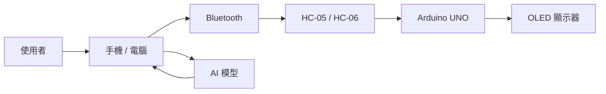

# AI FocusMate

## 智慧藍牙番茄鐘暨桌面 AI 陪伴裝置

> 結合 Arduino、Bluetooth、OLED 與 AI 陪伴訊息的桌面專注工具。

---

## 成品概念圖


---

## 專題介紹

AI FocusMate 是一個智慧桌面番茄鐘。

使用者可以透過手機或電腦，以 Bluetooth 傳送指令到 Arduino，設定番茄鐘並控制開始、暫停、繼續與重設。

OLED 會顯示倒數時間、目前狀態、簡單角色表情，也可以顯示 AI 產生的簡短鼓勵或提醒訊息。

---

## 主要功能

- 藍牙設定番茄鐘
- 手機／電腦控制開始、暫停、繼續與重設
- OLED 顯示剩餘時間
- 顯示專注、休息與完成狀態
- 顯示簡單桌面角色表情
- 顯示 AI 鼓勵或提醒訊息

---

## 系統架構



系統主要流程：

```text
使用者
   ↓
手機 / 電腦
   ↓
Bluetooth
   ↓
HC-05 / HC-06
   ↓
Arduino UNO
   ↓
OLED 顯示器
```

AI 訊息流程：

```text
使用者
   ↓
手機 / 電腦
   ↓
AI 模型
   ↓
產生簡短訊息
   ↓
Bluetooth
   ↓
Arduino UNO
   ↓
OLED 顯示
```

---

## 操作方式

### 1. 連接裝置

開啟 Arduino 裝置後，使用手機或電腦與 HC-05／HC-06 藍牙模組進行連線。

---

### 2. 設定番茄鐘時間

例如傳送：

```text
P25
```

代表設定 25 分鐘番茄鐘。

也可以傳送：

```text
P50
```

代表設定 50 分鐘番茄鐘。

---

### 3. 開始計時

傳送：

```text
START
```

Arduino 開始倒數。

OLED 顯示：

```text
FOCUS
24:36
( •̀ ω •́ )
```

---

### 4. 暫停計時

傳送：

```text
PAUSE
```

番茄鐘會暫停。

---

### 5. 繼續計時

傳送：

```text
CONTINUE
```

番茄鐘會從暫停的位置繼續倒數。

---

### 6. 重設番茄鐘

傳送：

```text
RESET
```

即可重新設定番茄鐘。

---

### 7. 番茄鐘完成

當倒數時間結束後，OLED 顯示完成畫面。

例如：

```text
DONE!
做得很好！
\(≧▽≦)/
```

之後也可以顯示 AI 產生的簡短鼓勵訊息。

例如：

```text
再完成這一輪，
就休息一下吧！
```

---

## 預計控制指令

| 指令 | 功能 |
|---|---|
| `P25` | 設定 25 分鐘 |
| `P50` | 設定 50 分鐘 |
| `START` | 開始計時 |
| `PAUSE` | 暫停計時 |
| `CONTINUE` | 繼續計時 |
| `RESET` | 重設番茄鐘 |

---

## 桌面角色

為了增加裝置的互動感，OLED 除了顯示倒數時間，也會根據不同狀態顯示角色表情。

### 待機狀態

```text
READY
^_^
```

### 專注狀態

```text
FOCUS
24:36
( •̀ ω •́ )
```

### 休息狀態

```text
BREAK
-.- zZ
```

### 完成狀態

```text
DONE!
\(≧▽≦)/
```

---

## AI 陪伴功能

Arduino UNO 本身不直接執行大型 AI 模型。

AI 功能會由手機或電腦端進行處理，產生簡短的鼓勵或提醒訊息，再透過 Bluetooth 傳送至 Arduino。

Arduino 收到訊息後，將內容顯示在 OLED 上。

例如：

```text
今天已經很努力了！
繼續加油！
```

或：

```text
再專注一下，
完成就休息吧！
```

這樣可以讓傳統番茄鐘除了計時之外，也具有簡單的 AI 陪伴功能。

---

## 使用硬體

| 元件 | 用途 |
|---|---|
| Arduino UNO | 系統主要控制器 |
| HC-05 / HC-06 | Bluetooth 藍牙通訊 |
| OLED 128×64 | 顯示倒數時間、角色與 AI 訊息 |
| 手機或電腦 | 設定番茄鐘、傳送指令及處理 AI 訊息 |

---

## 使用軟體

| 軟體 | 用途 |
|---|---|
| Arduino IDE | Arduino 程式開發 |
| C / C++ | Arduino 控制程式 |
| Bluetooth Terminal | 手機藍牙連線與指令測試 |
| Python（選配） | 電腦端通訊及 AI 整合 |
| AI 模型／API | 產生簡短陪伴訊息 |
| GitHub | 專題文件與程式碼管理 |

---

## 專題特色

一般番茄鐘通常只有倒數計時功能，本專題加入藍牙控制、OLED 桌面角色與 AI 陪伴功能。

主要特色包含：

1. 使用 Bluetooth 遠端控制番茄鐘。
2. 不需要額外的實體按鈕。
3. OLED 可同時顯示時間與角色。
4. 根據專注、休息與完成狀態改變顯示內容。
5. 可顯示 AI 產生的簡短鼓勵或提醒訊息。
6. 將時間管理與桌面陪伴功能整合在同一個裝置中。

---

## 預期成果

預計完成一個可放置於桌面的智慧番茄鐘原型。

使用者可以透過手機或電腦與裝置連線，設定番茄鐘時間並控制開始、暫停、繼續與重設。

OLED 將顯示：

- 番茄鐘倒數時間
- 專注狀態
- 休息狀態
- 完成狀態
- 桌面角色表情
- AI 鼓勵或提醒訊息

最終希望將 Arduino、Bluetooth、OLED、時間管理與 AI 互動功能整合成一套簡單且具有互動性的智慧桌面陪伴裝置。

---

## 專題文件

詳細專題計畫請參考：

[PROPOSAL.md](PROPOSAL.md)
